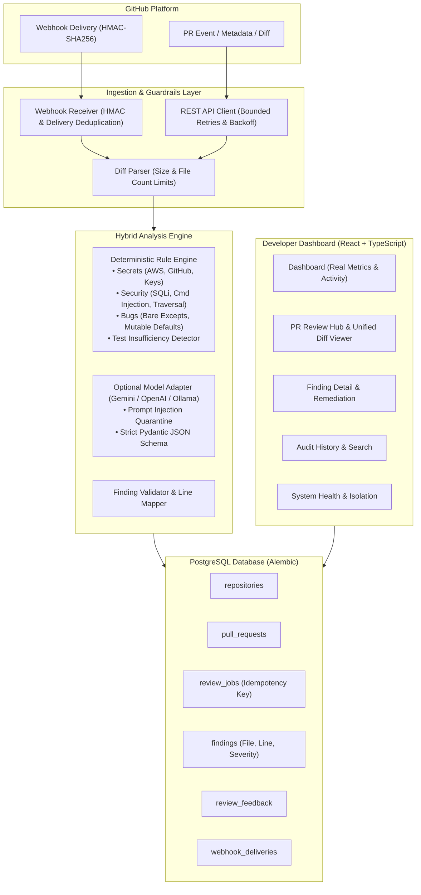

# DevGuard AI — System Architecture & Design

## 1. System Overview

**DevGuard AI** is a code review and security assistant engineered for GitHub Pull Requests. It merges high-speed deterministic static analysis (syntax checking, security AST patterns, secret entropy scanning, bug detection, test sufficiency verification) with an optional LLM review engine.

---

## 2. Component Breakdown

### 2.1 Unified Diff Parser (`app/services/diff_parser.py`)
- Standard unified git diff parser parsing hunks (`@@ -old,len +new,len @@`).
- Extracts precise additions, deletions, old/new file paths, and change types (`added`, `modified`, `deleted`, `renamed`).
- Generates mapped line tuples `(line_number, line_content)` for all modified/added lines in the new revision.
- Implements strict anti-DOS guardrails: rejects diffs larger than 1MB (`MAX_DIFF_BYTES`) or exceeding 50 changed files (`MAX_DIFF_FILES`).

### 2.2 Deterministic Static Analyzer (`app/engine/`)
- Executes instantly in `< 1ms` per diff with zero external network or model dependencies.
- **Secret Rules (`rules/secrets.py`)**: AWS key patterns, GitHub Personal Access Tokens, Private RSA/EC keys, high-entropy secrets.
- **Security Rules (`rules/security.py`)**: SQL injection in dynamic queries, command execution via `subprocess(..., shell=True)` and `os.system`, arbitrary code execution via `eval`/`exec`, unsafe YAML/pickle deserialization, path traversal.
- **Bug Rules (`rules/bugs.py`)**: Bare except statements (`except:`), mutable default arguments (`def foo(items=[])`), tuple asserts, unclosed resources.
- **Quality Rules (`rules/quality.py`)**: Leftover breakpoints/debuggers, console logs/prints, deep nesting (> 4 levels).
- **Test Insufficiency (`rules/tests.py`)**: PR-wide check detecting heavy core logic modifications (> 25 additions) with zero test file modifications.

### 2.3 Provider-Agnostic LLM Adapter (`app/engine/llm/`)
- Abstract interface `BaseLLMProvider`.
- Available adapters: `GeminiProvider`, `OpenAICompatibleProvider` (OpenAI, Ollama, Groq), `FallbackLLMProvider`.
- Outputs strictly validated against `ModelReviewOutput` Pydantic schema.
- **Prompt Injection Defense**: Untrusted code diffs and comments are quarantined between explicit instruction boundaries.
- **Line Validation**: Hallucinated file paths or line numbers outside the diff are stripped or mapped to valid changed lines.

### 2.4 Idempotency & Concurrency Invariants
- Each review job computes an idempotency key:
  $$\text{idempotency\_key} = \text{pr\_id} + \text{commit\_sha} + \text{mode}$$
- Enforced via unique database constraint `review_jobs.idempotency_key`. Concurrent or repeated review requests for the same commit return the existing cached or processing record rather than creating runaway jobs.
- Webhooks enforce uniqueness on GitHub `X-GitHub-Delivery` headers via `webhook_deliveries.delivery_id`.
